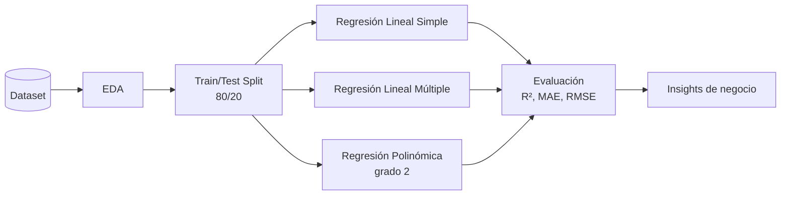

# 🛍️ RetailBoost – Predicción del Gasto Mensual de Clientes

> **Proyecto de Machine Learning para estimar el gasto mensual de clientes de un e-commerce mediante modelos de regresión y apoyar estrategias comerciales basadas en datos.**

<br>

<p align="center">

👥 **Dataset:** 500 clientes &nbsp;&nbsp;&nbsp;|&nbsp;&nbsp;&nbsp;
🎯 **Problema:** Regresión &nbsp;&nbsp;&nbsp;|&nbsp;&nbsp;&nbsp;
📈 **Mejor modelo:** Regresión Lineal Múltiple &nbsp;&nbsp;&nbsp;|&nbsp;&nbsp;&nbsp;
📊 **R²:** 0.34 &nbsp;&nbsp;&nbsp;|&nbsp;&nbsp;&nbsp;
💵 **MAE:** $241

</p>

<p>


</p>

---

# 📑 Tabla de contenidos

- [Descripción del proyecto](#-descripción-del-proyecto)
- [Objetivos](#-objetivos)
- [Dataset](#-dataset)
- [Estructura del repositorio](#-estructura-del-repositorio)
- [Cómo ejecutar](#-cómo-ejecutar)
- [Metodología](#-metodología)
- [Resultados](#-resultados)
- [Contexto de negocio](#-contexto-de-negocio)
- [Conclusiones](#-conclusiones)
- [Competencias demostradas](#-competencias-demostradas)
- [Autora](#-autora)

---

# 📌 Descripción del proyecto

RetailBoost es una empresa ficticia de comercio electrónico que busca comprender qué factores influyen en el gasto mensual de sus clientes.

Este proyecto desarrolla un pipeline de análisis y modelado predictivo para estimar el valor de **`monthly_spent`**, combinando análisis exploratorio de datos con modelos de regresión.

El objetivo no consiste únicamente en obtener buenas predicciones, sino también en interpretar cómo las variables demográficas y de comportamiento impactan sobre el gasto de los clientes.

---

# 🎯 Objetivos

- Comprender la estructura y calidad del conjunto de datos.
- Explorar las relaciones entre las variables predictoras y el gasto mensual.
- Implementar modelos de regresión lineal simple, múltiple y polinómica.
- Comparar el desempeño de los modelos.
- Interpretar los resultados para apoyar decisiones comerciales.

---

# 📂 Dataset

`data/retailboost_customers_regression.csv`: 500 clientes, sin valores faltantes.

| Variable | Descripción |
|---|---|
| `customer_id` | Identificador del cliente |
| `age` | Edad |
| `income` | Ingreso mensual |
| `visits_per_month` | Visitas al sitio por mes |
| `satisfaction_score` | Satisfacción (1 a 5) |
| `membership_years` | Antigüedad como cliente (años) |
| **`monthly_spent`** | **Variable objetivo:** gasto mensual ($) |

El gasto mensual promedio es de **$1.185**, con un rango de $50 a $4.389.

---

# 🗂 Estructura del repositorio

```
Retailboost-sales-prediction/
├── data/
│   └── retailboost_customers_regression.csv    # Dataset
├── notebooks/
│   └── 01_RetailBoost_Regression.ipynb         # EDA, modelado y evaluación
├── requirements.txt
└── README.md
```

---

# 🧪 Cómo ejecutar

```bash
git clone https://github.com/VaninaCavallin/Retailboost-sales-prediction.git
cd Retailboost-sales-prediction
pip install -r requirements.txt
jupyter notebook
```

Abrir `notebooks/01_RetailBoost_Regression.ipynb`. El notebook lee el dataset desde `../data/retailboost_customers_regression.csv`.

---

# 🔄 Metodología



1. **Análisis exploratorio:** estructura del dataset, valores faltantes, estadística descriptiva, distribución de la variable objetivo y correlaciones.
2. **Regresión Lineal Simple:** relación entre el ingreso (`income`) y el gasto mensual.
3. **Regresión Lineal Múltiple:** incorpora todas las variables para medir su efecto conjunto.
4. **Regresión Polinómica (grado 2):** evalúa si las relaciones no lineales mejoran el ajuste.
5. **Evaluación:** comparación con R², MAE y RMSE sobre el conjunto de prueba (20% de los datos).

---

# 📈 Resultados

| Modelo | R² | MAE | RMSE |
|---|---:|---:|---:|
| Regresión Lineal Simple (`income`) | 0.224 | $273 | $435 |
| **Regresión Lineal Múltiple** | **0.340** | **$241** | **$401** |
| Regresión Polinómica (grado 2) | 0.314 | $247 | $409 |

- La **Regresión Lineal Múltiple** fue el mejor modelo: explica el 34% de la variabilidad del gasto mensual, con un error promedio de $241.
- La regresión polinómica **no mejoró** el resultado, lo que indica que las relaciones entre variables son principalmente lineales y que agregar complejidad no aporta.
- Un R² de 0.34 indica que hay factores que influyen en el gasto y que no están en el dataset (por ejemplo, historial de compras o categoría de producto).

### Efecto de cada variable

Como las variables están en escalas distintas (el ingreso se mide en miles de dólares y la satisfacción de 1 a 5), los coeficientes no se pueden comparar directamente. La tabla muestra cuánto cambia el gasto mensual estimado cuando cada variable aumenta **un desvío estándar**:

| Variable | Coeficiente | Efecto de +1 desvío estándar |
|---|---:|---:|
| Ingreso (`income`) | 0.26 por $ | **+$255** |
| Satisfacción (`satisfaction_score`) | 71.5 por punto | +$101 |
| Antigüedad (`membership_years`) | 21.9 por año | +$94 |
| Visitas (`visits_per_month`) | 14.8 por visita | +$40 |
| Edad (`age`) | 0.08 por año | +$1 |

El **ingreso** es el factor con mayor peso sobre el gasto, seguido por la **satisfacción** y la **antigüedad**. La edad prácticamente no influye.

---

# 📊 Contexto de negocio

Comprender el comportamiento de compra permite:

- Identificar clientes de alto valor.
- Optimizar campañas de marketing.
- Personalizar promociones.
- Mejorar estrategias de fidelización: la satisfacción y la antigüedad son palancas que la empresa puede trabajar directamente, a diferencia del ingreso.
- Apoyar decisiones comerciales basadas en datos.

---

# ⭐ Conclusiones

El proyecto demuestra cómo un enfoque de regresión puede utilizarse para estimar el comportamiento económico de los clientes y transformar datos históricos en información útil para la toma de decisiones.

Asimismo, evidencia la importancia del análisis exploratorio, de la correcta selección de variables y de interpretar los coeficientes teniendo en cuenta la escala de cada variable.

---

# 💼 Competencias demostradas

- Análisis Exploratorio de Datos (EDA)
- Regresión Lineal Simple y Múltiple
- Regresión Polinómica
- Evaluación de modelos de regresión
- Interpretación de coeficientes
- Storytelling con datos
- Machine Learning aplicado a negocio

---

# 👩‍💻 Autora

**Vanina Cavallin**

Doctora en Ciencias Biológicas | Data Scientist | Data Analyst

💼 **LinkedIn:** https://linkedin.com/in/vanina-cavallin
